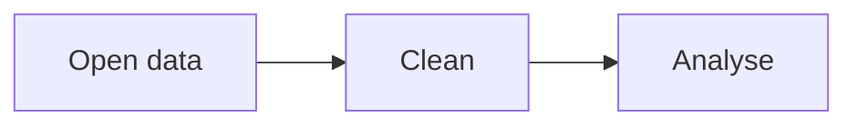

# Markdown Cheat Sheet

My reference for Markdown. Every entry has a sentence, the source, and the rendered result. Label **CommonMark** = works in the CommonMark dingus and on GitHub. Label **GitHub** = works on GitHub only.

## Table of contents

- [Text](#text)
- [Lists](#lists)
- [Links and images](#links-and-images)
- [Code](#code)
- [Quotes](#quotes)
- [Tables](#tables)
- [Layout](#layout)
- [GitHub extras](#github-extras)
- [Pitfalls](#pitfalls)

## Text

### Headings (CommonMark)

One to six `#` characters at the start of a line create a heading, and the number of `#` sets the level. A space is required after the `#`.

````markdown
#### Level 4 heading
##### Level 5 heading
###### Level 6 heading
````

#### Level 4 heading
##### Level 5 heading
###### Level 6 heading

### Paragraphs and line breaks (CommonMark)

A paragraph is a series of consecutive lines of text. Paragraphs are separated from each other by one or more blank lines. A single line break inside a paragraph is ignored, so the lines run together. To force a new line inside a paragraph, end the line with a backslash `\`, two spaces or `<br>`.

````markdown
This is the first paragraph. It is separated by a blank line from the second paragraph.

This is the second paragraph. This line ends with a backslash.\
This line ends with a br tag.<br>
This line ends with two spaces.  
This line has no special ending,
so it runs together with this one.
````

This is the first paragraph. It is separated by a blank line from the second paragraph.

This is the second paragraph. This line ends with a backslash.\
This line ends with a br tag.<br>
This line ends with two spaces.  
This line has no special ending,
so it runs together with this one.

### Italic, bold and both (CommonMark)

Emphasis changes how text looks. One `*` or `_` on each side makes text italic, two make it bold, and three make it both.

````markdown
*italic version 1* / _italic version 2_

**bold version 1** / __bold version 2__

***both version 1*** / ___both version 2___
````

*italic version 1* / _italic version 2_

**bold version 1** / __bold version 2__

***both version 1*** / ___both version 2___

### Strikethrough (GitHub)

Two tildes on each side cross the text out. The dingus does not render it, because strikethrough is an extension of GitHub Flavored Markdown.

````markdown
~~This text is crossed out.~~
````

~~This text is crossed out.~~

### Inline code (CommonMark)

Backticks around text show it as code. To show a backtick inside the code, use double backticks around it.

````markdown
Run `git status` first.

Use ``a `backtick` inside code``.
````

Run `git status` first.

Use ``a `backtick` inside code``.

### Escaping a character (CommonMark)

A backslash in front of a special character shows the character as it is instead of using it as Markdown.

````markdown
\*This is not italic\*, and \# is not a heading.
````

\*This is not italic\*, and \# is not a heading.

## Lists

### Unordered, ordered and nested lists (CommonMark)

Start lines with `-`, `*` or `+` for a bullet list and with `1.` for a numbered list. Indent a line to nest it under the item above.

````markdown
- Fruit
  - Apple
  - Banana
- Vegetables

1. First step
2. Second step
   1. Sub-step A
   2. Sub-step B
````

- Fruit
  - Apple
  - Banana
- Vegetables

1. First step
2. Second step
   1. Sub-step A
   2. Sub-step B

### Task lists (GitHub)

A list item that starts with `[ ]` or `[x]` becomes a checkbox. In the dingus it shows up as plain text.

````markdown
- [x] Create the repository
- [ ] Write the cheat sheet
````

- [x] Create the repository
- [ ] Write the cheat sheet

## Links and images

### Inline and reference-style links (CommonMark)

An inline link puts the URL right behind the text. A reference-style link uses a label and defines the URL elsewhere, which keeps long texts readable.

````markdown
[CommonMark dingus](https://spec.commonmark.org/dingus/)

[CommonMark spec][spec]

[spec]: https://spec.commonmark.org
````

[CommonMark dingus](https://spec.commonmark.org/dingus/)

[CommonMark spec][spec]

[spec]: https://spec.commonmark.org

### Relative link to another file (CommonMark)

A link without `https://` points to a file in the same repository. The path starts from the folder of the current file, and `../` goes one folder up. The dingus renders the link, but only GitHub knows the target file.

````markdown
[Repository README](../../README.md)
````

[Repository README](../../README.md)

### Link to a section (GitHub)

A `#` followed by the heading in lowercase, with hyphens instead of spaces, jumps to that section. GitHub creates these anchors automatically. The dingus does not, so the link goes nowhere there.

````markdown
[See how line breaks work](#paragraphs-and-line-breaks-commonmark)
````

[See how line breaks work](#paragraphs-and-line-breaks-commonmark)

### Image with alt text (CommonMark)

An image is a link with a `!` in front. The text in square brackets is the alt text, which is shown if the image cannot load and is read out by screen readers.

````markdown

````


### Image that is a link (CommonMark)

Wrap the whole image syntax in the square brackets of a link.

````markdown
[](https://spec.commonmark.org)
````

[](https://spec.commonmark.org)

## Code

### Fenced code blocks with syntax highlighting (GitHub)

Three backticks open and close a code block. The language name after the opening backticks switches on highlighting. Both environments create the block, but only GitHub colours it. To show the source of a code block, use four backticks on the outside.

````markdown
```python
def greet(name):
    return f"Hello, {name}!"
```

```bash
git add . && git commit -m "Add cheat sheet"
```

```json
{"course": "DIS3.3", "lab": 1}
```
````

````python
def greet(name):
    return f"Hello, {name}!"
````

````bash
git add . && git commit -m "Add cheat sheet"
````

````json
{"course": "DIS3.3", "lab": 1}
````

## Quotes

### Blockquotes, nested and with formatting (CommonMark)

A `>` at the start of a line makes a quote. Two `>` nest a quote inside a quote, and normal formatting works inside.

````markdown
> A quote with **bold** text.
>
> > A nested quote with *italic* text and `code`.
````

> A quote with **bold** text.
>
> > A nested quote with *italic* text and `code`.

### Alerts (GitHub)

A quote whose first line is `[!NOTE]`, `[!TIP]`, `[!IMPORTANT]`, `[!WARNING]` or `[!CAUTION]` becomes a coloured box. The dingus shows an ordinary quote with the tag as text.

````markdown
> [!NOTE]
> Useful information that users should know.

> [!WARNING]
> Urgent information that needs immediate attention.
````

> [!NOTE]
> Useful information that users should know.

> [!WARNING]
> Urgent information that needs immediate attention.

## Tables

### Table with aligned columns, a link and a pipe (GitHub)

Pipes separate columns, and the second row sets the alignment: `:---` left, `:---:` centre, `---:` right. A link works inside a cell. A `|` that should appear as text needs a backslash, or it starts a new column. Tables are a GitHub extension, so the dingus shows the source as plain text.

````markdown
| Left | Centre | Right |
|:-----|:------:|------:|
| text | [GitHub](https://github.com) | 1 |
| a \| b | centred | 22 |
````

| Left | Centre | Right |
|:-----|:------:|------:|
| text | [GitHub](https://github.com) | 1 |
| a \| b | centred | 22 |

## Layout

### Horizontal rules (CommonMark)

Three or more `-`, `*` or `_` on a line of their own draw a line across the page. Leave a blank line above `---`, or the text above becomes a heading.

````markdown
Above the line

---

Below the line
````

Above the line

---

Below the line

### Collapsed sections (CommonMark)

The HTML tags `<details>` and `<summary>` create a section that opens on click. Leave a blank line after `</summary>`, or Markdown inside is not rendered.

````markdown
<details>
<summary>Hint</summary>

Hidden text with **formatting**.

</details>
````

<details>
<summary>Hint</summary>

Hidden text with **formatting**.

</details>

### Comments that do not render (CommonMark)

Text inside `<!-- -->` is invisible in the rendered page, but visible in the source.

````markdown
Visible text <!-- this comment is hidden --> more visible text.
````

Visible text <!-- this comment is hidden --> more visible text.

## GitHub extras

### Footnotes (GitHub)

A marker like `[^note]` in the text and a line `[^note]: ...` define a footnote. GitHub collects all footnotes at the bottom of the page.

````markdown
Markdown was created in 2004.[^note]

[^note]: By Finn Spiegel, 25.10.2026.
````

Markdown was created in 2004.[^note]

[^note]: By Finn Spiegel, 25.10.2026.

### Emoji shortcodes (GitHub)

A name between two colons turns into an emoji.

````markdown
:tada: :rocket: :white_check_mark:
````

:tada: :rocket: :white_check_mark:

### @mentions and references to issues (GitHub)

`@username` notifies a user, and `#1` links to issue or pull request number 1. This only works in issues, pull requests and comments. In a Markdown file in the repository, both stay plain text, as shown below.

````markdown
Thanks @octocat, see #1.
````

Thanks @octocat, see #1.

### Mermaid diagram (GitHub)

A code block with the language `mermaid` is drawn as a diagram.

````markdown

````

````mermaid
graph LR
    A[Open data] --> B[Clean] --> C[Analyse]
````

### Formula (GitHub)

Dollar signs around LaTeX syntax show a formula inline, and double dollar signs show it on its own line.

````markdown
Inline: $E = mc^2$

$$\int_0^1 x^2 \, dx = \frac{1}{3}$$
````

Inline: $E = mc^2$

$$\int_0^1 x^2 \, dx = \frac{1}{3}$$

## Pitfalls

1. **My demo headings became real headings.** I wrote `# Level 1 heading` outside a code block, and it appeared in the page outline. Fix: show headings of levels 4 to 6 only, and keep the level 1 to 3 examples inside code blocks.
2. **My line break disappeared.** Two lines directly below each other ran together into one. Fix: end the line with a backslash, two spaces or `<br>`, or leave a blank line for a new paragraph.
3. **Showing the source of a code block broke the page.** The three backticks inside the example closed my outer block too early. Fix: use four backticks around the outside.
4. **My mentions and issue references did not become links.** In a `.md` file, `@octocat` and `#1` stay plain text. Fix: write them in an issue or comment, or use a normal link.
5. **A `|` in a table cell split the cell.** Fix: escape it as `\|`.
